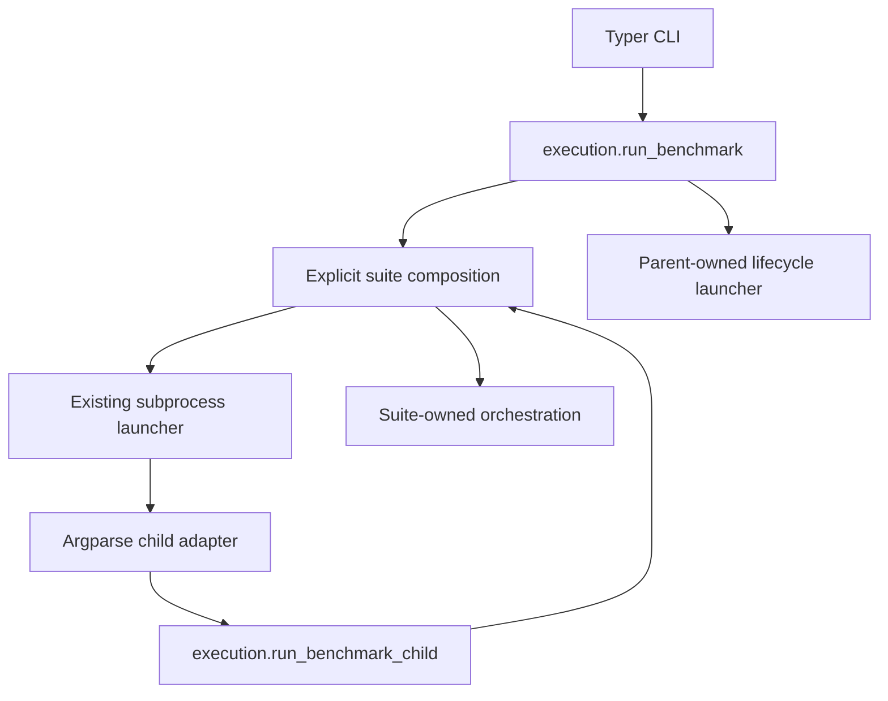

# Application execution

Benchmark execution lives in `application/execution.py`. The Typer CLI and
the internal argparse child entrypoint translate their input into concrete
`BenchmarkArgs` and call this module. Application execution imports neither
adapter and does not depend on Typer or Click.



## Ownership

| Module | Responsibility |
| --- | --- |
| `cli.py` | CLI options, omitted-option defaults, comparison command and user-facing parameter errors |
| `_child.py` | Child argument parsing, construction of effective arguments and parameter-error exit code 2 |
| `application/execution.py` | Provenance preflight, progress lifetime and parent/child execution policy |
| `application/composition.py` | Supported suite lookup and explicit connections between selection, isolation scenarios, execution and report finalization |
| Suite-local `suite.py` and `request_suite.py` | Validation, plans, server contexts, runner arguments, settling and report publication |
| `isolation/execution.py` | Sequential child process execution, diagnostics, cooldown and report merge |
| `isolation/reports.py` | Child admission, diagnostics, guarded finalization and mandatory general validity |

Proxy ratios and streaming metadata agreement belong to their suites. The
application passes the composed finalizer through the launcher to the merger;
the process layer imports neither concrete suite finalizers nor the composition
root. See [merged report semantics](merged-report-semantics.md).

`run_benchmark(args, *, show_progress=True)` is the programmatic parent entry.
`run_benchmark_child(args, *, show_progress=False)` is the entry for the
existing child-process adapter. Both accept effective arguments; suite/profile
defaults for omitted CLI options remain in `resolve_cli_defaults`. See
[CLI configuration](cli-configuration.md).

The parent verifies research provenance with `check_remote=True` before
entering progress or starting work. Default runs use the existing isolated
launcher, including when a programmatic caller supplies another `isolation`
value. Lifecycle and async-bytes profiles use their parent-owned launcher;
async-bytes retains its manifest requirement.

The child rechecks local provenance, rejects lifecycle profiles and replaces
the isolation metadata with `CHILD_PROCESS_ISOLATION` before suite execution.
`application.composition.run_benchmark_suite` is an internal child implementation. Its dispatch is not
an alternative public entry for running workloads without isolation.

Progress construction remains after preflight in the application layer so the
order of checks and resource lifetime is unchanged. Application errors and
cancellation propagate to the caller. CLI and child adapters translate only
`TypeError` and `ValueError` into their existing parameter-error presentation.

## Import migration

The execution functions previously exported by `foghttp_benchmark.cli` now
belong to `foghttp_benchmark.application.execution`:

```python
from foghttp_benchmark.application.execution import run_benchmark, run_benchmark_child
```

There is no execution re-export from `cli.py`. CLI commands, flags, effective
argument values, exit codes, JSON schemas and output locations are unchanged.
The comparison command and its reporting path retain their existing owner.

Tests patch the owner they exercise: `application.execution` for preflight
and launch selection, the suite-local owner for orchestration, and the
actual CLI or child adapter when checking argument/error translation. No
application import points back to a CLI module to preserve an old test seam.

The former internal `application.suites` module has been removed. Its dispatcher
is now `application.composition.run_benchmark_suite`; individual orchestration
functions belong to the modules listed in [Suite composition](suite-composition.md).
The former `validation.validate_suite` lookup belongs to `composition.get_suite`.

## Verification

The moved suite functions retain their workload, server/cleanup contexts,
settling, runner calls and report arguments. No measurement algorithms or
scientific baselines change as part of this separation.

`tests/application` checks shell delegation, parameter errors, all eight suite
routes, provenance/isolation ownership, progress, failure/cancellation
propagation and import without loading CLI frameworks or starting subprocess
or network work. Existing CLI defaults, child, lifecycle and research
preflight tests continue to check the same behavior at the new owners.
