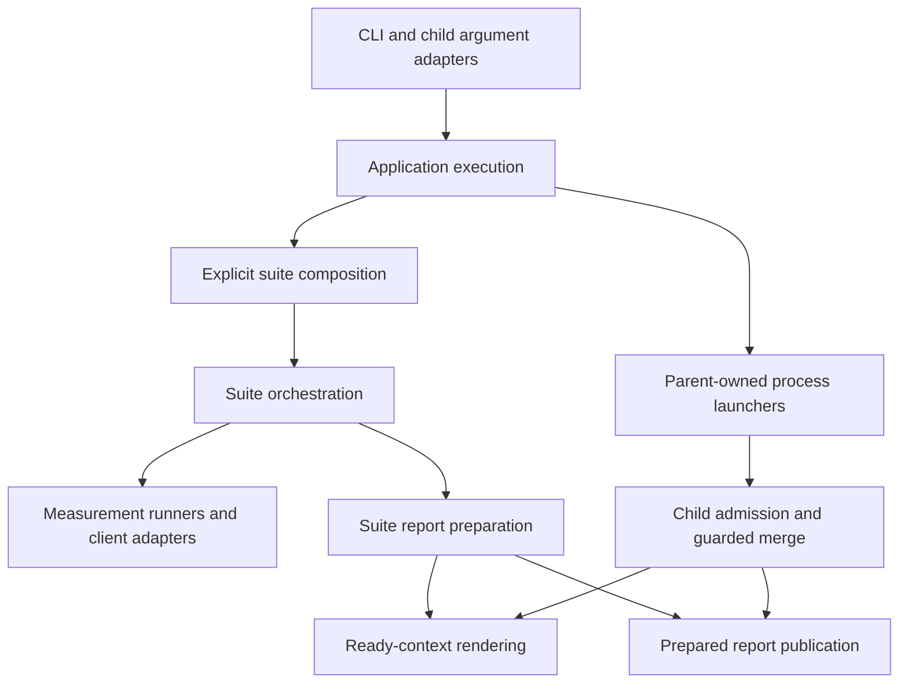

# Benchmark architecture

This document describes the current dependency boundaries. Suites own their
workload semantics. Shared modules contain contracts or mechanisms reused across
callers.
FogHTTP remains an external dependency; this project does not implement its
transport or native streaming delivery path.

## Execution and dependency direction



The subprocess child re-enters application execution through `_child.py`.
Lifecycle and async-bytes use their existing parent-owned launcher. The diagram
groups responsibilities across modules; the publication contracts below
identify the ordinary and specialized paths.

| Owner | Responsibility and boundary |
| --- | --- |
| `cli.py`, `_child.py` | Translate command-line input and parameter errors. Omitted CLI defaults belong here; supplied `BenchmarkArgs` values are effective arguments. |
| `application/execution.py` | Provenance preflight, progress lifetime and parent/child execution policy. Does not import CLI frameworks or argument adapters. |
| `application/composition.py` | Connect the eight ordinary suites through `SuiteDefinition`: execution, client selection, scenario projection and required merge finalizer. |
| `request_suite.py`, suite-local `suite.py`, `streaming/lifecycle.py` | Validate workload settings, build plans, own server/cleanup contexts, call runners and publish reports. |
| `runner.py`, suite runners and streaming workers | Construct adapters, execute warmup/load, sample resources, verify outcomes and close owned resources. Do not call rendering or publication directly. |
| `clients/`, specialized client registries/factories | Adapt third-party APIs to the relevant suite contract and report availability/skip reasons. |
| `models.py`, suite models, `streaming/attribution_payloads.py` | Typed effective arguments, mode-specific factories and internal measurement records. External JSON admission remains separate. |
| `measurement_timing.py`, `resource_metrics.py`, `statistics.py` | Named timing compatibility, nullable resource aggregation/coverage, and shared ordinary statistical primitives. |
| `streaming/report_values.py` | Existing tolerant projections of mixed internal JSON values. Does not validate saved reports. |
| `streaming/lifecycle_aggregation.py`, `streaming/attribution_aggregation.py` | Pure profile aggregation, diagnostics and profile-specific optional statistics, separate from writer imports. |
| `streaming/attribution_validation.py` | Verify raw sidecars and recompute stored aggregates. Owns the existing evidence read boundary, not report publication. |
| `report_schema/`, `validity/` | Decode saved report structure/identities and classify measurement restrictions. A structurally accepted report is not automatically comparable. |
| Suite report modules | Aggregate suite results and prepare timestamps, displayed environment/package data, provenance, validity, JSON payload and render context. |
| `report_finalization.py`, suite finalizers | Carry composed merge contracts and suite-specific post-merge semantics. General admission and validity stay in the merger. |
| `rendering.py`, `templates/` | Load Markdown templates explicitly, then render ready contexts. Rendering does not probe environment, classify validity or publish files. |
| `report_publication.py` | Serialize prepared ordinary JSON and write named/latest JSON and Markdown sequentially. Does not aggregate, render or decide validity. |
| `compare/` | Load admitted reports and calculate comparisons from recorded evidence. Does not execute benchmark workloads. |

The import rules follow these responsibilities. Measurement modules consume
typed results and shared mechanisms. Orchestration and report
preparation may depend on rendering and publication. `package_versions`
currently remains in request `reports.py` and is reused by other writers.
`creation`, `streaming` and `isolation` package initializers contain no eager re-exports;
loading a contract submodule no longer loads their runners and report writers
through those package facades.

For the exact execution and merge contracts, see
[application execution](application-execution.md),
[suite composition](suite-composition.md) and
[merged report semantics](merged-report-semantics.md).

## Invariants to preserve

- **Modes and cleanup:** select the matching frozen sync or async client spec,
  not an independent mode/factory pair. Preserve the existing worker/thread
  boundary, cancellation behavior and close order. Adapter statistics are
  `ClientStats | None` where supported; a client library needs no benchmark
  statistics API. See [client contracts](client-adapters.md).
- **Timing:** keep warmup, sampler setup/teardown, load and postprocessing at
  their declared boundaries. Changes to measured semantics need a new timing
  scope and explicit compatibility handling. Equal metric names do not establish
  equal intervals. See [timing contracts](measurement-timing.md).
- **Unavailable resources:** preserve `None`/JSON `null`, real zero, signed
  creation deltas and recorded coverage. Do not fill absent observations with
  zero or infer complete coverage from available maxima. Ordinary process
  resources describe the colocated client/server/harness, not isolated client
  cost. See [resource measurements](resource-measurements.md).
- **Statistics:** ordinary CV and lifecycle/attribution optional CV have
  different minimum-sample and unavailable-value contracts. Do not interchange
  them. Shared percentile consumes already sorted samples; suite grouping,
  ratios and validity thresholds remain suite policies. See
  [statistical primitives](statistical-primitives.md).
- **Admission and identities:** route saved inputs through the shared reader.
  Reject duplicate complete aggregate identities before filtering, comparison
  or parent normalization. Never pick a first/last row or average duplicates to
  repair evidence. Saved, current and child validity restrictions combine
  conservatively. See [report schemas](report-schemas.md).
- **Streaming evidence:** EOF, expected length, digest, framing, cancellation,
  early-close recovery and server health retain their existing checks. Partial
  reads cannot become verified throughput. Internal `TypedDict` annotations do
  not validate loaded JSON or replace raw-sidecar checks. See
  [streaming records](streaming-measurement-types.md).
- **Research provenance:** keep the isolated release-wheel source identity,
  manifest/fingerprint checks, raw sidecar hashes and summary recomputation.
  Stored PASS flags or a package version string cannot replace those checks.
  Controls and diagnostics/profiler runs retain their distinct eligibility;
  do not rank a diagnostic row as an unprofiled control. See
  [research contracts](async-streaming-research.md).
- **Report preparation:** finish the caller's aggregation, metadata, evidence,
  validity and Markdown preparation before invoking the ordinary publisher.
  Preserve templates, escaping and file formats. Publication is sequential,
  with no rollback or multi-file atomicity. Lifecycle/attribution sidecars and
  publication order, and comparison's Markdown-only output, remain separate
  contracts. See [rendering](report-rendering.md) and
  [publication](report-publication.md).

## Adding a suite

1. Put scenarios/cases, typed client contracts, measurement runner and
   orchestration beside the suite. Reuse a shared mechanism only when its
   semantics match; do not hide new policy in a generic helper.
2. Register one ordinary `SuiteDefinition` with all four callbacks. Use
   `preserve_merged_report` when no suite-specific finalization is needed.
   A finalizer cannot replace general validity, change aggregate identities or
   overwrite reserved parent metadata. Research profiles use their existing
   explicit launcher and evidence path.
3. Deliberately extend CLI defaults/validation, timing scope, saved report
   layout and identity, comparison mapping, validity and template as required.
   Registration does not generate these contracts automatically.
4. Test parent selection, child dispatch, deterministic plans, unsupported
   inputs, effective argument forwarding and cleanup/failure/cancellation.
   Add saved-report/merge/comparison tests for new semantics before using the
   suite as performance evidence.

## Adding a client

1. Implement the relevant suite adapter, including its fixed mode and close
   behavior. Use the existing nominal base or suite protocol. Unsupported stats
   return `None`; request-builder has no stats contract.
2. Add factories returning the corresponding sync or async adapter and register
   the matching `*ClientSpec`. Preserve requested order and availability/skip
   behavior in both parent selection and child discovery.
3. Test positive and negative factory typing, actual mode dispatch, outcome
   verification, cleanup and optional stats. Preserve sync work inside its
   current thread boundary; avoid adding wrappers or conversions inside a
   measured interval without revisiting its timing contract.

## Adding a report field or report output

1. Decide whether the field is an internal measurement, aggregate, recorded
   metadata or display-only value, and change its owner first. Extend raw
   admission, nullable coverage, identity and compatibility rules where relevant.
   Never make a required value optional solely to admit a malformed fixture.
2. Prepare displayed values outside rendering. Extend the relevant typed render
   context or retain the existing suite-specific row type, and pass a loaded
   template. Keep environment probes, provenance and validity out of renderers.
3. Use `publish_report` only for its existing prepared ordinary file contract.
   Preserve specialized research/sidecar and comparison publication where their
   serialization, ordering or failure behavior differs.
4. Verify representative JSON/Markdown contents, `None`, escaping, row order,
   render purity, admission and publication failure behavior. New report
   presentation alone does not authorize rewriting historical evidence.

## Internal import migration

Import functions and constants from their actual owners. The former eager
package exports have been removed without compatibility proxies:

| Former import owner | Symbol | Current owner |
| --- | --- | --- |
| `creation` | `run_client_creation_benchmarks` | `creation.runner` |
| `streaming` | `streaming_cases` | `streaming.cases` |
| `streaming` | `available_streaming_clients` | `streaming.clients` |
| `streaming` | `run_response_streaming_benchmarks` | `streaming.runner` |
| `streaming` | `write_streaming_reports` | `streaming.reports` |
| `isolation` | `run_isolated_benchmark` | `isolation.execution` |
| `isolation` | `CHILD_PROCESS_ISOLATION`, `PER_CLIENT_SCENARIO_ISOLATION`, `SUPPORTED_ISOLATION_MODES` | `isolation.models` |
| `streaming.lifecycle_reports` | `aggregate_lifecycle_results`, `child_diagnostic`, `MEASUREMENT_SCOPE`, optional statistics | `streaming.lifecycle_aggregation` |
| `streaming.lifecycle_reports` | `object_value`, `object_list`, `list_value`, `number`, `int_value` | `streaming.report_values` |
| `streaming.attribution_reports` | `aggregate_attribution_results`, `TIMING_SCOPE`, `integer` | `streaming.attribution_aggregation` |
| `streaming.attribution_reports` | `revalidate_attribution_rows` | `streaming.attribution_validation` |

All module names in the table are relative to `foghttp_benchmark`. For example:

```python
from foghttp_benchmark.isolation.execution import run_isolated_benchmark
from foghttp_benchmark.streaming.lifecycle_aggregation import cv_optional
```

The moved aggregation functions preserve their existing calculations and
unavailable-value behavior. `report_values` retains the prior tolerant internal
projections, including their fallback values; these helpers are not saved-input
admission or a reason to replace a missing resource measurement with zero.
Schema admission still performs raw-sidecar revalidation through its explicit
owner. CLI arguments, report layouts and scientific eligibility do not change.

## Import checks and verification

`tests/architecture/` checks selected direct import edges in five groups:

- Shared neutral contracts/mechanisms retain their allowed project dependencies
  and reject CLI frameworks.
- Application execution does not depend on CLI/child argument adapters or CLI
  frameworks; suite orchestration does not depend back on application execution.
- Isolation does not choose application composition or concrete suite merge
  policies.
- Saved-report parsing and validity do not import report writers, rendering or
  publication.
- Measurement modules do not import rendering or publication directly.

The AST checks inspect normal, nested, relative and `TYPE_CHECKING` imports.
Their narrow type-only exceptions are explicit in the tests, including ready
render-context model annotations. `validity.reports` prepares validity metadata
and performs no file publication, so its name alone is not a writer dependency.
Negative fixtures check import forms and
rule violations. They do not import benchmark modules to inspect source.
These checks are not whole-graph dependency analysis or proof about dynamic
imports; importing a suite aggregation module can still bring its own allowed
dependencies.

Separate cold-process smoke tests check the actual import closure of the named
shared modules, schema and validity paths without loading report writers. This
is a bounded regression check for those entrypoints, not a promise that every
runtime import is isolated. Behavior tests remain necessary for timing,
evidence, cleanup, render purity and filesystem operations.

Use the locked development environment for the complete checks:

```bash
uv sync --locked --extra dev
uv lock --check
uv run --locked --extra dev ruff format --check .
uv run --locked --extra dev ruff check .
uv run --locked --extra dev mypy
uv run --locked --extra dev pytest -q tests/architecture
uv run --isolated --locked --extra dev --python 3.11 pytest -q
uv run --isolated --locked --extra dev --python 3.14 pytest -q
uv run --locked --extra dev pre-commit run --all-files
```

The provided mypy hook checks the project using `.venv/bin/python`; sync the
development environment first. Hooks can modify formatting, so review their
changes. Include new untracked files explicitly in a hook run before committing;
`--all-files` selects tracked files. Report failures and environment limitations
without adding skips, changing validity thresholds or bypassing gates.

Correctness tests with synthetic/local fixtures are not research runs. A
refactor does not establish a fresh performance baseline or justify a FogHTTP
optimization. Existing scientific evidence remains unchanged.
