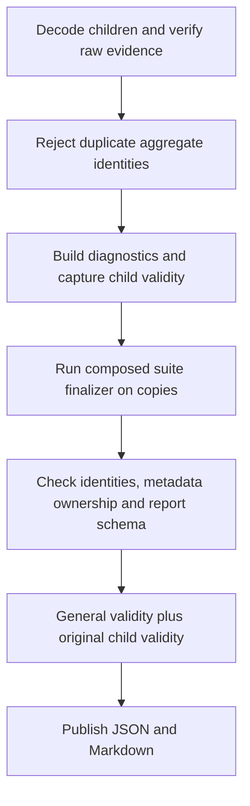

# Merged report semantics

Ordinary isolated benchmarks finalize suite semantics after combining child
reports. The process layer owns report admission, child diagnostics and general
validity. Suite owners supply only the post-merge aggregate values and additional
suite metadata.

## Required composition

`SuiteDefinition.finalize_report` is required for every ordinary suite.
The application passes it through `run_isolated_benchmark` to
`write_isolation_report`; neither function chooses a concrete suite policy.
The six suites without post-merge transformations explicitly use
`preserve_merged_report`.

The shared callable contract is defined in `report_finalization.py`:
`finalizer(rows, children_metadata) -> MergedSuiteReport`. The result contains
aggregate rows and additional suite metadata. It does not contain runs, generic
parent metadata, diagnostics or an optional validity decision.

The merger gives the finalizer copies of rows and child metadata. It captures
original child validity before invoking it and retains the original runs and
provenance. The result must preserve aggregate identities, count and order;
duplicate identities are rejected before and after finalization. Replacing
common metadata is an error, including reserved fields such as validity,
schema version, provenance and timing even when they were absent from the parent.

Schema validation and general validity always run after suite finalization.
The resulting validity is conservatively combined with original child validity.
A suite callback cannot make a failed child valid or remove its diagnostics.
Finalization failures are raised before replacing report files; existing child evidence and
previously published reports remain available.

## Proxy CONNECT

`proxy_connect/finalization.py` owns the only direct-ratio algorithm. Both the
typed aggregate producer and the merged JSON path use it. The typed adapter in
`proxy_connect/reports.py` retains the original dataclass rows and changes only
their `direct_ratio` field.

A baseline remains a `config=direct`, `lifecycle=reused-client` row, matched by
`(mode, client, target_scheme, concurrency)`. The ratio remains
`ok_req_s_median / baseline.ok_req_s_median`. Missing or nonpositive baselines
produce `null`. A baseline in another child is available after merging.

Previously, multiple direct rows with the same baseline key overwrote each
other according to row order. Different `request_limit`, group or case values
can be distinct aggregate identities while still sharing that key. Such input
now raises `AmbiguousDirectBaselineError`, regardless of input order. Duplicate
aggregate identities are rejected first. No winner is selected, and neither
the baseline key nor the population is silently changed.

This is a correctness guard, not a new claim of scientific comparability.
The existing ratio definition and interpretation limits still apply. Historical
artifacts are not rewritten or requalified by this change.

## Response streaming

`streaming/finalization.py` owns the child metadata agreement rules:

- `measurement_scope`, `streaming_metric_schema_version` and
  `bytes_payload_policy` must agree exactly. If any child supplies a field,
  every child must supply it. Missing and explicit `null` remain distinct.
- Declared `throughput_scopes` and `timing_scopes` must be lists of strings
  in every child. Their merged values are sorted, deduplicated unions.
- Fields absent from every child remain absent; empty child lists and empty
  scope lists retain their existing behavior.

Incompatibility raises `StreamingMetadataMergeError`, a `ValueError` subclass
with the existing diagnostic messages. General timing agreement, report schema,
resource coverage, provenance and raw-sidecar validation keep their original
owners and remain mandatory. Lifecycle and async-bytes orchestration is unchanged.

## Internal migration and compatibility

Direct internal callers of `write_isolation_report` now supply
`finalizer=get_suite(args.suite).finalize_report`. The process launcher also
requires that callback. Removed process-specific proxy and streaming helpers
are replaced by their suite owners. The public application entry remains
`application.execution.run_benchmark`.

CLI arguments, JSON field names, schema versions, result paths and unambiguous
ratio values are unchanged. This task changes no measurement loops or FogHTTP
code and requires no benchmark rebaseline.
